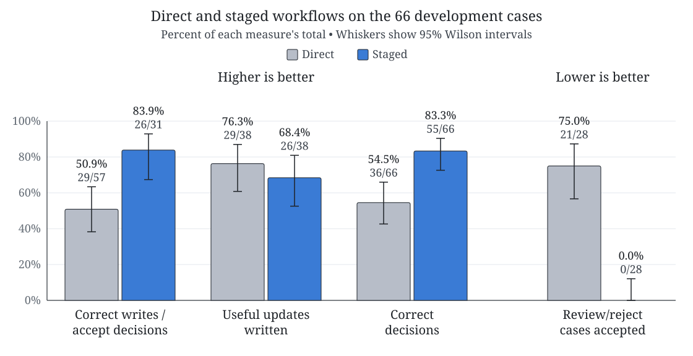
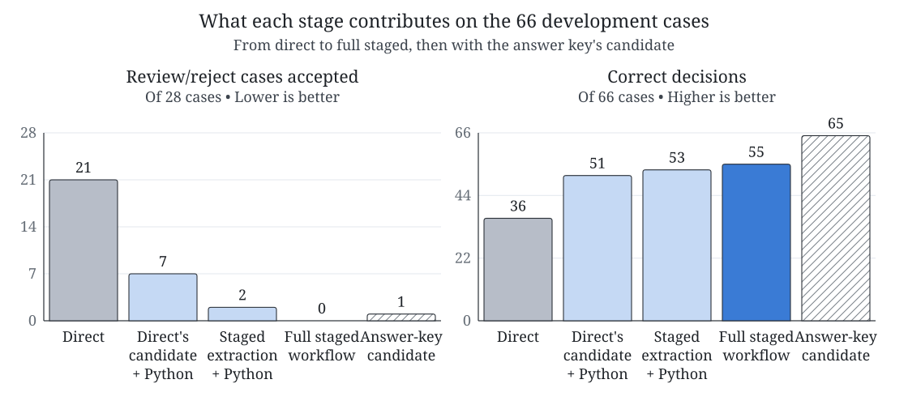

# Source-grounded CRM extraction

My independent study for EAS 0099 (Fall 2026), supervised by Professor Benjamin C. Pierce.

A document might say that someone became CFO, or that one company bought another. Before a
customer relationship management (CRM) system can use that, something has to pull out the
fact, find the right record, check the evidence, and then **accept** the update, send it for
**review**, or **reject** it. I want to know whether splitting this work into steps makes the
updates more reliable, so I compare two workflows that use the same small local model.

```text
Direct: sources + CRM -> one model response (fact, match, decision) -> CRM writer
Staged: sources -> model extraction -> Python matching against the CRM
        -> model evidence check -> Python decision rules -> CRM writer
```

## Development results

<picture>
  <source media="(max-width: 767px)" srcset="assets/fig-results-narrow.svg">
  
</picture>

The staged workflow makes 5 incorrect writes where direct makes 28. It writes 3 fewer useful
updates, but with only 38 useful cases that cost is uncertain. The 95% interval runs from
staged writing 4 more to staged writing 10 fewer.

<picture>
  <source media="(max-width: 767px)" srcset="assets/fig-stages-narrow.svg">
  
</picture>

Most of the gain comes from the Python matching and decision rules. "+ Python" means that these
two steps run on the candidate with no verifier. The hatched bar gives the verifier and the
Python steps the answer key's candidate. They then make 65 of 66 correct decisions, so most of
the remaining errors come from extraction.

These cases guided the design, so the numbers do not predict how the workflows do on new
documents. The 66 test cases are kept for that, and the final report will cover them.

The [progress update](reports/EAS_0099_Progress_Update.pdf) explains the project with
references, the [design memo](docs/design.md) covers the rules and measures, and the
[analysis tables](results/analysis/development.md) have more detail.

## Try it

You need Python 3.11 or later. None of this needs the model.

```bash
python3 -m venv .venv
.venv/bin/pip install -e '.[dev,report]'
.venv/bin/pytest -q
.venv/bin/python scripts/demo.py                  # one saved case through both workflows
.venv/bin/python scripts/analyze_development.py   # rebuild the analysis tables
.venv/bin/python scripts/build_figures.py         # rebuild the figures above
.venv/bin/python scripts/build_report.py          # rebuild the progress update
```

To run the model itself on Apple silicon (the first run downloads about 2 GB):

```bash
.venv/bin/pip install -e '.[local]'
.venv/bin/python scripts/run_experiment.py --split dev --out results/my-run
```

The [experiments page](docs/experiments.md) has the settings.

## What is where

| Path | Contents |
| --- | --- |
| `src/crm_study/` | The workflows, matching, decision rules, scoring, and the `crm-study` command |
| `scripts/` | Dataset build, experiment runner, analysis, figures, progress update, and demo |
| `tests/` | Tests for the rules, the CRM writer, the scoring, and the runner |
| `data/` | Cases, answer keys, and the selected FewRel records ([notes](docs/dataset.md)) |
| `results/` | Saved runs and the analysis built from them ([guide](results/README.md)) |
| `configs/`, `docs/` | The run settings, and the [design](docs/design.md), [dataset](docs/dataset.md), and [experiment](docs/experiments.md) notes |
| `assets/`, `reports/` | The figures above with their font, and the progress update |

## Data and tools

| Resource | What I use it for | Reference |
| --- | --- | --- |
| [FewRel 1.0](https://github.com/thunlp/FewRel) (MIT license) | 60 public passages | [Han et al., EMNLP 2018](https://aclanthology.org/D18-1514/) |
| [Qwen3-4B, 4-bit](https://huggingface.co/mlx-community/Qwen3-4B-4bit) (Apache 2.0) | The model in both workflows | [Yang et al., 2025](https://arxiv.org/abs/2505.09388) |
| [MLX and mlx-lm](https://github.com/ml-explore/mlx-lm) (MIT license) | Running the model on Apple silicon | [Hannun et al., 2023](https://github.com/ml-explore/mlx) |

The other 72 cases, the simulated CRM records, the permission labels, and the answer keys were
written for this project.
