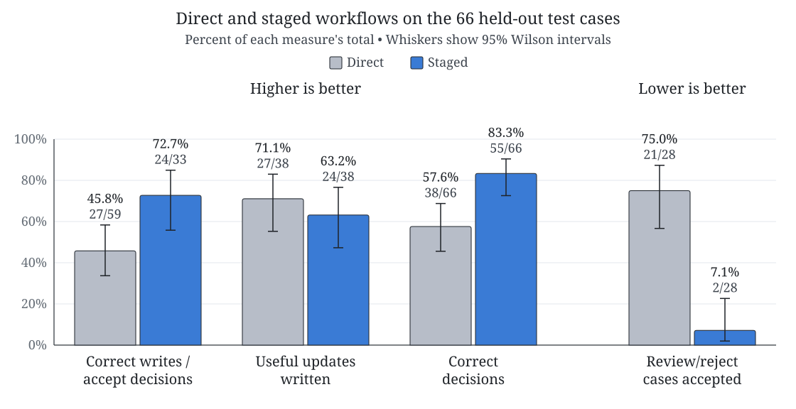
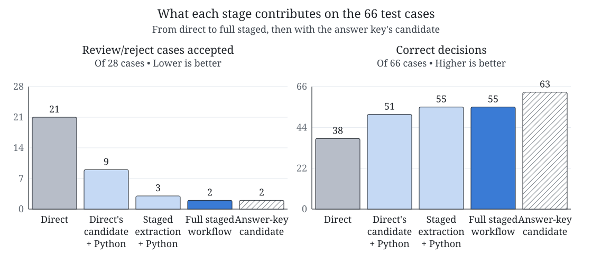
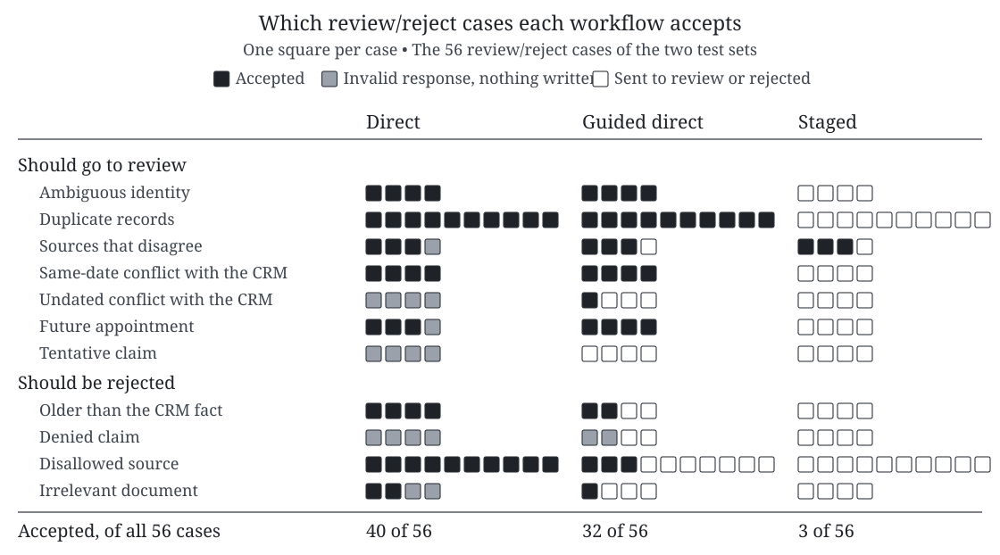
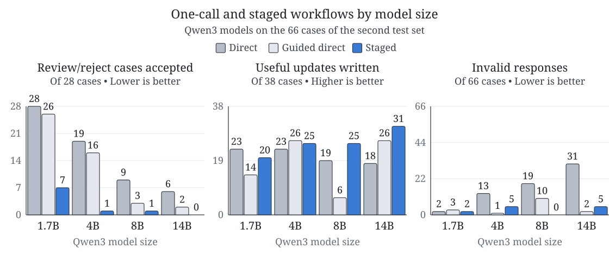

# Source-grounded CRM extraction

My independent study for EAS 0099 (Fall 2026), supervised by Professor Benjamin C. Pierce.

A document might say that someone became CFO, or that one company bought another. Before a
customer relationship management (CRM) system can use that, something has to pull out the
fact, find the right record, check the evidence, and then **accept** the update, send it for
**review**, or **reject** it. I wanted to know whether splitting this work into steps makes the
updates more reliable, so I compared two workflows that use the same small local model.

```text
Direct: sources + CRM -> one model response (fact, match, decision) -> CRM writer
Staged: sources -> model extraction -> Python matching against the CRM
        -> model evidence check -> Python decision rules -> CRM writer
```

The [final report](reports/EAS_0099_Final_Report.pdf) has the full results and references. The
earlier [progress update](reports/EAS_0099_Progress_Update.pdf) covers the development cases.

## Results

<picture>
  <source media="(max-width: 767px)" srcset="assets/fig-results-narrow.svg">
  
</picture>

On the 66 held-out test cases, the staged workflow accepted 2 of the 28 cases that needed
review or rejection, and direct accepted 21. Staged wrote 3 fewer useful updates, a difference
that could be chance with only 38 useful cases.

<picture>
  <source media="(max-width: 767px)" srcset="assets/fig-stages-narrow.svg">
  
</picture>

Most of the gain comes from doing the matching and the decision in Python. "+ Python" means
that these two steps run on the candidate with no verifier. The hatched bar feeds the answer
key's candidate to the verifier and the Python steps. They then make 63 of 66 correct
decisions, so most of the remaining errors come from extraction.

After the test I fixed four problems in the Python steps and built a second test set of 66 new
cases to check the fixes. On those cases the fixes raised correct writes from 21 to 25 of 38.

<picture>
  <source media="(max-width: 767px)" srcset="assets/fig-kinds-narrow.svg">
  
</picture>

The two test sets together have 132 cases that I did not use to build or tune the workflows,
56 of them review/reject cases. Direct never sent one of those to review or rejected it with a
valid response. Guided direct is a stronger one-call prompt with explicit checks and worked
examples. It held back all 4 tentative claims, 7 of the 10 disallowed sources, and 3 of the 4
irrelevant documents, but it still accepted every ambiguous identity, duplicate record,
same-date conflict, and future appointment. Most of what it let through needs a comparison
with the CRM records or the as-of date. Staged makes that comparison in Python, and the only
cases it accepted were three with sources that disagree.

<picture>
  <source media="(max-width: 767px)" srcset="assets/fig-models-narrow.svg">
  
</picture>

Staged gets better as the model gets larger. Direct returns more invalid responses with larger
models, usually a match that contradicts itself, and an invalid response writes nothing. Guided
direct depends a lot on the model. With Qwen3-8B it wrote only 6 useful updates, and with
Qwen3-14B it came close to staged with the same model, with 2 review/reject cases accepted and
26 useful updates where staged had 0 and 31. Staged with Qwen3-4B does about as well as guided
direct with Qwen3-14B, in about a quarter of the time per case.

The tables behind these figures are in [results/analysis](results/analysis/), with one page per
set of cases and one for the [comparisons across runs](results/analysis/comparisons.md).

## Try it

You need Python 3.11 or later. None of this needs the model.

```bash
python3 -m venv .venv
.venv/bin/pip install -e '.[dev,report]'
.venv/bin/pytest -q
.venv/bin/python scripts/demo.py           # one saved test case through both workflows
.venv/bin/python scripts/analyze.py        # rebuild the analysis tables
.venv/bin/python scripts/build_figures.py  # rebuild the figures above
.venv/bin/python scripts/build_report.py   # rebuild the final report
```

Two more cases worth a look are a source conflict that staged misses, and a date the model
invented, before and after the fix:

```bash
.venv/bin/python scripts/demo.py --case-id scenario-06-3
.venv/bin/python scripts/demo.py --case-id fewrel-p39-0025
.venv/bin/python scripts/demo.py --case-id fewrel-p39-0025 --run results/fixes-test
```

To run the model itself on Apple silicon (the first run downloads about 2 GB):

```bash
.venv/bin/pip install -e '.[local]'
.venv/bin/python scripts/run_experiment.py --split test2 --out results/my-run
```

The [experiments page](docs/experiments.md) lists every saved run and how to repeat it.

## What is where

| Path | Contents |
| --- | --- |
| `src/crm_study/` | The workflows, matching, decision rules, scoring, and the `crm-study` command |
| `scripts/` | Dataset build, experiment runner, analysis, figures, report, and demo |
| `tests/` | Tests for the rules, the CRM writer, and the scoring, and the regression tests |
| `data/` | Cases, answer keys, and the selected FewRel records ([notes](docs/dataset.md)) |
| `results/` | Saved runs and the analysis built from them ([guide](results/README.md)) |
| `configs/`, `docs/` | The run settings, and the [design](docs/design.md), [dataset](docs/dataset.md), and [experiment](docs/experiments.md) notes |
| `assets/`, `reports/` | The figures above with their font, and the two reports |

## Data and tools

| Resource | What I use it for | Reference |
| --- | --- | --- |
| [FewRel 1.0](https://github.com/thunlp/FewRel) (MIT license) | 90 public passages | [Han et al., EMNLP 2018](https://aclanthology.org/D18-1514/) |
| [Qwen3, 4-bit](https://huggingface.co/mlx-community/Qwen3-4B-4bit) (Apache 2.0) | The model in both workflows, in four sizes | [Yang et al., 2025](https://arxiv.org/abs/2505.09388) |
| [MLX and mlx-lm](https://github.com/ml-explore/mlx-lm) (MIT license) | Running the models on Apple silicon | [Hannun et al., 2023](https://github.com/ml-explore/mlx) |

The other 108 cases, the simulated CRM records, the permission labels, and the answer keys were
written for this project.
